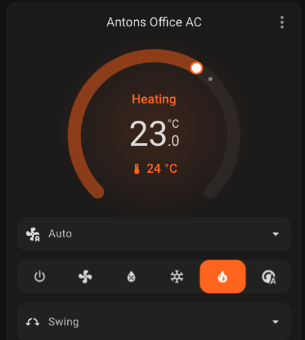
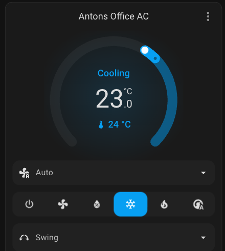
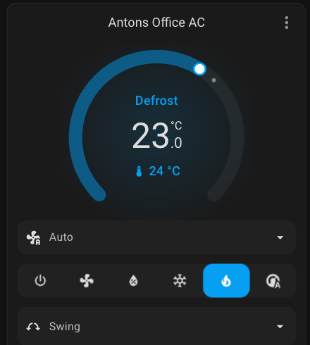

# Mitsubishi AC Thermostat Card

A Home Assistant Lovelace card for Mitsubishi heat pumps running the
[`echavet/MitsubishiCN105ESPHome`](https://github.com/echavet/MitsubishiCN105ESPHome)
ESPHome component. It wraps the native `thermostat` card and adds the
CN105-specific presentation and controls that component doesn't ship with.

| Heating | Cooling | Defrost |
|---|---|---|
|  |  |  |

## Why this exists

The CN105 ESPHome component gives Home Assistant a real `climate` entity with
correct modes, temperature, and `hvac_action` — but a few things it reports
don't come through in the stock `thermostat` card, or in a form a human
wants to read at a glance:

- **Sub-modes only exist as separate diagnostic sensors.** CN105 exposes
  two text sensors, `sub_mode` (`NORMAL` / `DEFROST` / `WARMUP` /
  `PREHEAT` / `STANDBY`) and `auto_sub_mode` (`AUTO_HEAT` / `AUTO_COOL` /
  `AUTO_LEADER` / `AUTO_ACTIVE` / ...), but the native card has no way to
  fold them into its own coloring or label. Defrosting looks identical to
  normal heating unless you go check a separate sensor.
- **Fan speed labels follow the component's internal enum order and
  naming.** The native dropdown shows `auto` / `quiet` / `low` / `medium`
  / `middle` / `high` in ESPHome's declaration order, instead of the
  unit's actual 1–5 speed numbering printed on the remote, and `middle`
  vs `medium` reads as a typo rather than two different speeds.
- **Vertical vane position has no UI in the stock setup.** CN105 exposes
  it as a `select` entity with its own 7 options, but nothing surfaces it
  inside the thermostat card — it would otherwise need a second, separate
  card underneath.

This card fixes those three things without touching the real entity state
that the rest of Home Assistant sees: everything is a read-only override
of the native card's presentation for one render cycle, plus a vane
control that calls the entity's own `select.select_option` service like
any other UI would.

## What it does

- **Wraps `type: thermostat`** (via `helpers.createCardElement`), so it
  keeps every native behavior (header toolbar, more-info, size/grid
  behavior, theming) for free. See [Architecture](#architecture) for why.
- **Colors and labels the dial from the real sub-mode sensors:**

  | State | Color | Label override |
  |---|---|---|
  | `hvac_action: heating` | orange | — (native) |
  | `hvac_action: cooling` | blue | — (native) |
  | `heat` or `cool` mode, idle (satisfied, waiting) | green | — (native) |
  | `dry` mode / `hvac_action: drying` | teal | — (native) |
  | `fan_only` mode / `hvac_action: fan` | green | — (native) |
  | `sub_mode: DEFROST` | blue | "Defrost" |
  | `sub_mode: WARMUP` | green | "Warmup" |
  | `sub_mode: PREHEAT` | green | "Preheat" |
  | `sub_mode: STANDBY` | green | "Standby" |
  | `auto_sub_mode: AUTO_HEAT` | orange | "Heating" |
  | `auto_sub_mode: AUTO_COOL` | blue | "Cooling" |
  | `auto_sub_mode: AUTO_LEADER` / `AUTO_ACTIVE` | grey | "Auto (Leader)" / "Auto (Active)" |
  | unavailable / unknown, or mode `off` | grey | — |

  Green marks "the unit is on and operating but not actively delivering
  heat or cold" — that covers warmup/preheat/standby, and plain idle
  while heat or cool mode is selected (setpoint reached, waiting). Grey is
  reserved for mode `off` and unavailable/unknown. Defrost shares the
  cooling blue deliberately — the unit is reverse-cycling, same as active
  cooling, just for a different reason.

- **Reorders and relabels the fan speed dropdown** to `Auto, 1, 2, 3, 4, 5`
  — the same numbering printed on the physical remote — while the actual
  service call underneath still sends CN105's real `fan_mode` string
  (`quiet`, `middle`, etc.). Nothing about the entity changes; only what's
  drawn in the dropdown.
- **Adds a 7-position vertical vane control** inside the same card body,
  reusing HA's own `ha-control-select-menu` and swing icon so it looks
  like a native feature row:

  `Auto, 1 - Up, 2, 3, 4, 5 - Down, Swing`

## Requirements

- Home Assistant with the [`echavet/MitsubishiCN105ESPHome`](https://github.com/echavet/MitsubishiCN105ESPHome)
  component (tested against CN105 component `2026.11.1`, ESPHome `2026.10.2`).
- The `sub_mode` and `auto_sub_mode` diagnostic text sensors enabled (they're
  disabled-by-default diagnostic entities — enable via the entity's settings).
- A `select` entity for vertical vane position, if you want that row (the
  card works without `vertical_vane_entity` configured — it just omits the row).

## Installation

**Via HACS** (recommended):

1. HACS → ⋮ → Custom repositories → add `https://github.com/blackeyeliner/mitsubishi-ac-thermostat`, category **Plugin**.
2. Find "Mitsubishi AC Thermostat" in HACS and install it. HACS registers the
   Lovelace resource automatically.

**Manual install** (no HACS):

1. Copy `ac-thermostat-card.js` to `<config>/www/mitsubishi-ac-thermostat/`.
2. Add it as a Lovelace resource:
   ```yaml
   resources:
     - url: /local/mitsubishi-ac-thermostat/ac-thermostat-card.js
       type: module
   ```
   (Or Settings → Dashboards → Resources in the UI.)

Then add the card to a dashboard:
   ```yaml
   type: custom:ac-thermostat-card
   entity: climate.your_ac_entity
   sub_mode_entity: sensor.your_ac_cn105_sub_mode
   auto_sub_mode_entity: sensor.your_ac_cn105_auto_sub_mode
   vertical_vane_entity: select.your_ac_cn105_vertical_vane   # optional
   ```

## Architecture

The card never touches the real `climate` entity's state or attributes —
Home Assistant's own automations, history graphs, voice assistants, etc.
all see the unmodified entity exactly as CN105 reports it. All of the
presentation logic works by:

1. Setting CSS custom properties (`--state-climate-heat-color`, etc.) on the
   wrapped native card, scoped to just that card instance.
2. Monkey-patching the native temperature control's `render()` and
   `_renderLabel()` methods for a single render pass, to substitute a label
   or suppress the glow animation — then restoring normal rendering
   immediately after.
3. Reordering/relabeling the native fan-mode feature's already-rendered
   `<ha-control-select-menu>` options in place (same `value`s, different
   `label`s/order) after every hass update, since the native feature
   redraws its own options from the entity's declared order on each render.
4. Mounting one extra `<ha-control-select-menu>` as a light-DOM child of the
   wrapped card's `<ha-card>`, so it renders inside the same card body via
   `ha-card`'s own `<slot>` rather than as a second bordered card.

This is the same pattern used by this household's other custom card
(`heating_pulse_controller_v2/www/thermostat-card.js`, not public): wrap the
native card, patch presentation surgically, never fork the whole component.

### Known limitations

- DOM traversal into the native card's shadow tree
  (`hui-thermostat-card` → `hui-card-features` → `hui-card-feature` →
  `hui-climate-fan-modes-card-feature` → `ha-control-select-menu`) relies on
  Home Assistant frontend internals, not a public API. A future HA frontend
  refactor could break the fan-mode relabeling with no error raised.

## Scope

Built for [`echavet/MitsubishiCN105ESPHome`](https://github.com/echavet/MitsubishiCN105ESPHome):
`resolveAcPresentation()` matches that component's exact sub-mode strings
(`DEFROST`, `AUTO_HEAT`, `WARMUP`, ...) and its fan/vane enum/glyph
values. A different Mitsubishi integration or vendor component falls back
to a plain native thermostat card — the sub-mode coloring and label fixes
are specific to CN105's own sensor vocabulary.
